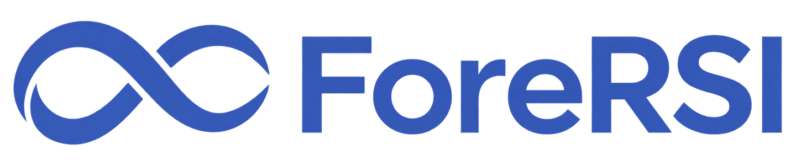

<h1 align="center">
  <picture>
    <source media="(prefers-color-scheme: dark)" srcset="docs/assets/fore-rsi-dark.png">
    
  </picture>
</h1>

<p align="center">基于 Agent Team 的 RSI 框架，自主并行探索方案、执行工作、验证效果，并以反馈驱动持续改进。</p>

<p align="center">
  <a href="README.md">English</a> · 简体中文
</p>

<p align="center">
  <a href="LICENSE"></a>
  <a href="https://nodejs.org/"></a>
</p>

ForeRSI 是一个基于 Agent Team 的递归自我改进（Recursive Self-Improvement，RSI）框架。设定目标与约束后，Agent Team 可以自主并行探索方案、协作执行工作、验证效果，并根据反馈调整方案和工作方法，持续推进迭代。

ForeRSI 采用去中心化协作理念：Agent 成员直接交流与共享进展，减少信息转发瓶颈，提升并行度；单个成员出现异常时，其他独立工作仍可继续推进。

用户可以通过终端对话提供材料、调整要求和管理任务。完整使用指南、工作流教程与接口参考见[文档](docs/README.md)。

## 快速开始

需要 Node.js 22.19.0 或更高版本，以及 npm。

### 1. 安装

```bash
npm install -g github:shiweijiezero/fore-rsi
```

<details>
<summary>也可以从本地源码安装</summary>

在 ForeRSI 仓库根目录执行：

```bash
npm install
npm install -g .
```

</details>

<details>
<summary>更新或卸载安装版</summary>

从 GitHub 安装时，重新执行对应的安装命令即可更新。从本地源码安装时，在原仓库目录执行：

```bash
git pull --ff-only
npm install
npm install -g .
```

两种安装方式均使用以下命令卸载：

```bash
npm uninstall -g fore-rsi
```

</details>

### 2. 启动与登录

在希望处理的项目目录中启动：

```bash
fore-rsi
```

进入终端界面后，使用 Pi 原生命令完成登录和模型选择：

```text
/login
/model
```

`/login` 用于选择模型服务商，按提示使用订阅登录或配置 API Key；也可以沿用环境变量中的 `OPENAI_API_KEY`、`ANTHROPIC_API_KEY` 等凭据。

`/model` 选择与你对话的 Coordinator（协调者）的模型，`/thinking` 调整其推理强度。

工具以运行 ForeRSI 的系统用户权限执行，默认无需逐次审批。

<details>
<summary>使用网络代理</summary>

需要代理时，在启动前设置以下变量。将示例中的 `http://127.0.0.1:7890` 替换为实际 HTTP 代理地址：

```bash
export HTTP_PROXY=http://127.0.0.1:7890
export HTTPS_PROXY=http://127.0.0.1:7890
export NO_PROXY=localhost,127.0.0.1,::1
fore-rsi
```

</details>

### 3. 设定目标并进行 RSI 工作

在对话中设定任务目标、约束、可用资源与时间预算。工作流定义团队角色和执行步骤；可以在任务要求中指定角色组成、并行数量、Agent 后端、模型与推理强度。团队会据此自主推进。

> 优化 SGLang 上的 BF16 Qwen3.5-35B-A3B，在请求并发 1 和 16 时提高输出 token 吞吐、降低每个输出 token 的耗时（TPOT），并保持回答质量。单机最多使用两张沐曦 C500，时间预算为 24 小时，交付推荐配置、测量结果与改动说明。
>
> 团队并行度设置为：4 个 Explorer 探索和比较方案，4 个 Worker 执行方案，2 个 Verifier 负责验证。其余角色沿用工作流预设。

新建任务时，可以通过 `--workflow` 选择工作流：省略时使用 `default`，推理优化使用 `inference`。恢复任务时沿用已保存的工作流。

也可以通过 `--task` 提交写好的 Markdown 任务文件。例如，在 ForeRSI 仓库根目录运行 [SGLang 吞吐优化任务](tasks/inference-optimization/sglang-throughput.md)：

```bash
fore-rsi --workflow inference \
  --task tasks/inference-optimization/sglang-throughput.md
```

使用自己的任务时，将路径替换为实际文件路径。进入对话后，可继续补充要求，并用 `@` 查找和引用代码、配置、数据等文件。仅提供目标时，团队会自主准备初始方案并开始第一轮工作。

### 4. 命名与恢复会话

启动时可以为会话命名：

```bash
fore-rsi --name "推理吞吐优化"
```

在对话中用 `/name` 修改名称，用 `/session` 查看会话 ID。下列恢复命令按需选择，`ID` 替换为实际会话 ID：

```bash
fore-rsi --resume       # 打开会话选择器，可以搜索名称
fore-rsi --continue     # 继续当前目录最近的会话
fore-rsi --session ID   # 按会话 ID 恢复
```

## 持续改进循环

<p align="center">
  
</p>

### 任务迭代

1. 探索方案：围绕目标与约束，分析已有材料、比较可行路径，形成可执行方案。
2. 执行工作：落实方案，产出代码、配置、分析、文档等可供验证的结果。
3. 验证效果：通过测试、测量、模拟或人工评阅取得反馈，对照目标与约束评估结果，决定保留或调整。

反馈回到探索与执行，指导下一轮改进。探索阶段也可以直接请求反馈。

Coordinator 对接用户要求与任务进展，Checker 负责方案、工作和结论的阶段检查。用户可以通过对话补充要求与材料，暂停、继续或结束任务。

### Watchdog：监督与改进工作流

Watchdog（看门狗）定期巡查任务进展和团队协作，识别停滞、重复尝试与交接问题，向相关成员提出调整建议并跟进处理。它关注整个流程是否顺畅、有效，并总结可复用的工作经验。

### 人类与 Agent：迭代整体 Harness

人类与 Agent 根据任务经验和 Watchdog 反馈，共同改进 Harness——支撑整个团队运行的框架，包括协作流程、提示词、工具接入、调度与恢复机制。Harness 迭代作为独立维护任务开展，完成设计、实现与验证后，再将改进应用于后续任务。

## 设计你的定制 RSI 工作流

工作流定义团队角色、工具、执行步骤和交接规则。可以复用已有工作流，也可以按任务需要编写自己的工作流。

工作流可以携带领域提示词、参考资料、专业知识、工作方法和评价标准。

- 软件开发：迭代实现功能或算法，通过测试与反馈改进。
- 推理优化：优化 Foretoken、SGLang、vLLM 等推理系统的代码、配置与运行表现。
- 科学研究：结合专业文献、数据、模拟和专家评阅组织工作。

## 贡献

欢迎社区开发者参与 ForeRSI。开发环境、代码与文档规范、Pull Request 流程见[贡献指南](CONTRIBUTING_zh.md)。

感谢所有通过代码、文档、想法和反馈帮助 ForeRSI 改进的[贡献者](https://github.com/shiweijiezero/fore-rsi/graphs/contributors)。

## 许可证

[Apache License 2.0](LICENSE)。
